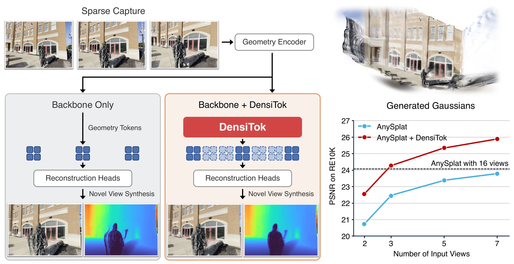
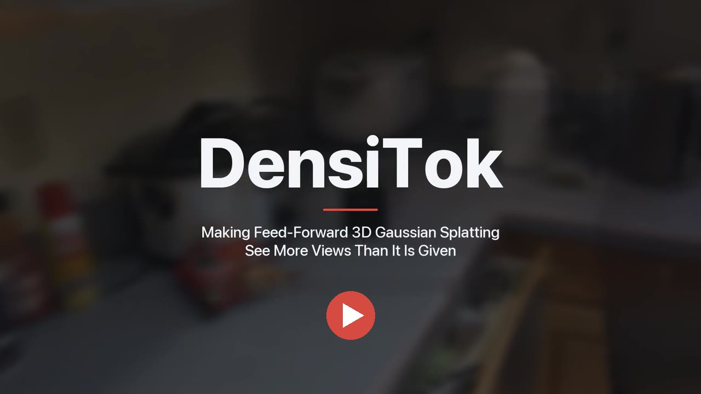
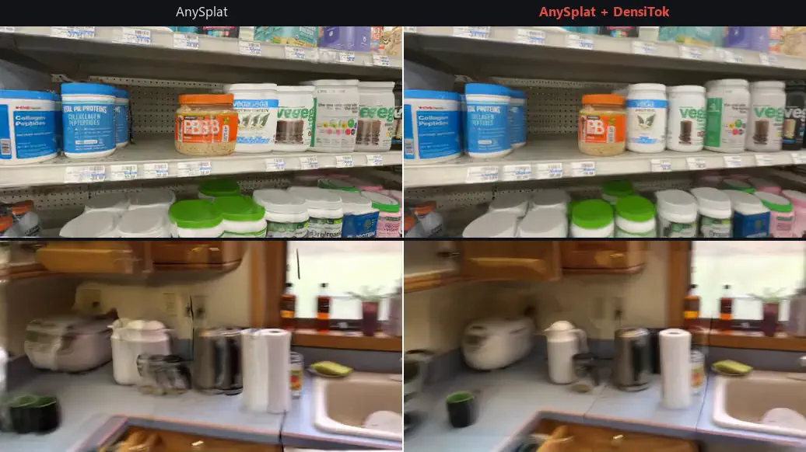
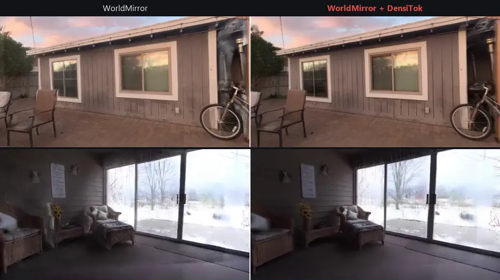
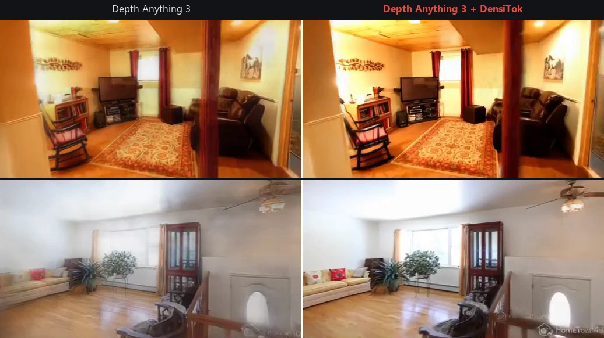

<div align="center">

# DensiTok

### Making Feed-Forward 3D Gaussian Splatting See More Views Than It Is Given

[**Minhyeok Lee**](https://hydragon.co.kr/)<sup>1\*</sup> &nbsp;·&nbsp;
[**Jungho Lee**](https://jho-yonsei.github.io/)<sup>2\*</sup> &nbsp;·&nbsp;
[**Minseok Kang**](https://minseokii.github.io/)<sup>1</sup> &nbsp;·&nbsp;
**Heeseung Choi**<sup>3</sup> &nbsp;·&nbsp;
**Ig-Jae Kim**<sup>3</sup> &nbsp;·&nbsp;
**Sangyoun Lee**<sup>1</sup>

<sup>1</sup>Yonsei University &nbsp;&nbsp; <sup>2</sup>NAVER AI Lab &nbsp;&nbsp; <sup>3</sup>Korea Institute of Science and Technology (KIST)

<sup>\*</sup>Equal contribution

[](https://arxiv.org/abs/2610.07958)
[](https://hydragon.co.kr/DensiTok/)
[](https://hydragon.co.kr/DensiTok/#video)


</div>

<p align="center">
  
</p>

**DensiTok** is a plug-in for pretrained feed-forward 3D Gaussian Splatting models. Instead of synthesizing extra images, it generates the *geometry tokens* of views that were never captured, so a frozen backbone reconstructs as if it had been given a dense capture.

- All token levels are compressed into a **4-channel latent**, and the unobserved views are completed in **a single flow-matching step**. No image is synthesized and the encoder is not run again.
- On **AnySplat**, **WorldMirror** and **Depth Anything 3**, rendering quality improves at every sparse-view setting.
- With **3 input views, AnySplat + DensiTok renders better than AnySplat with 16**, and faster (0.27 s vs. 0.43 s).

## 📢 News

- **[2026.10]** The paper is out on [arXiv](https://arxiv.org/abs/2610.07958), and the [project page](https://hydragon.co.kr/DensiTok/) is live.
- 🚧 Code and pretrained models are **coming soon**. Watch or star this repository to get notified.

## 🎬 Video

<p align="center">
  <a href="https://hydragon.co.kr/DensiTok/#video">
    
  </a>
  <br>
  <em>Click to watch the 3-minute overview.</em>
</p>

## 🖼️ Results

Novel-view renderings from **3 unposed input views**. In each clip, the left half is the backbone alone and the right half is the same frozen backbone with DensiTok.

<p align="center">
  
</p>
<p align="center">
  
</p>
<p align="center">
  
</p>

## 💻 Code

Coming soon.

## 📝 Citation

If you find DensiTok useful in your research, please consider citing:

```bibtex
@article{lee2026densitok,
  title   = {{DensiTok}: Making Feed-Forward {3D} {Gaussian}
             Splatting See More Views Than It Is Given},
  author  = {Lee, Minhyeok and Lee, Jungho and Kang, Minseok and
             Choi, Heeseung and Kim, Ig-Jae and Lee, Sangyoun},
  journal = {arXiv preprint arXiv:2610.07958},
  year    = {2026}
}
```
